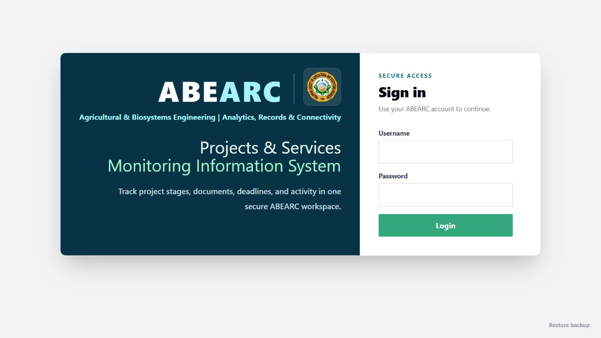
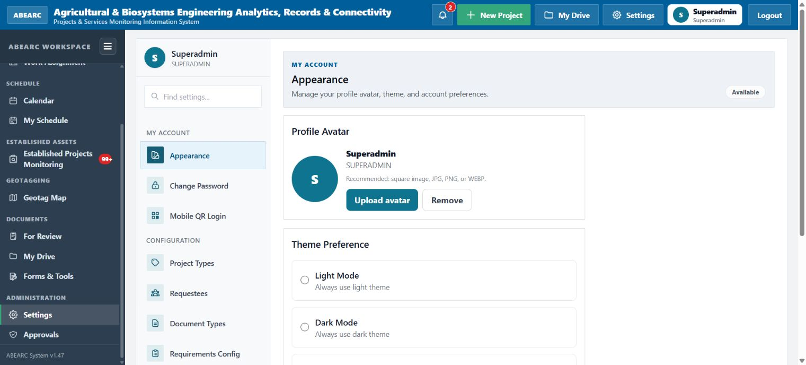

# ABEARC User Guide

This guide explains the main ABEARC workspace, its feature areas, and a practical project workflow. Exact buttons and available records depend on the privileges assigned to your account.

## Contents

1. [Signing in](#signing-in)
2. [Understanding the workspace](#understanding-the-workspace)
3. [Recommended project workflow](#recommended-project-workflow)
4. [Dashboard](#dashboard)
5. [Assignments and workload](#assignments-and-workload)
6. [Calendar and schedules](#calendar-and-schedules)
7. [Documents and review](#documents-and-review)
8. [Established projects monitoring](#established-projects-monitoring)
9. [Geotag Map](#geotag-map)
10. [My Drive](#my-drive)
11. [Forms and tools](#forms-and-tools)
12. [Account and mobile QR login](#account-and-mobile-qr-login)
13. [Administration](#administration)
14. [Backups and restoration](#backups-and-restoration)
15. [Good operating practices](#good-operating-practices)
16. [Troubleshooting](#troubleshooting)

## Signing in

1. Open the ABEARC server address supplied by your administrator.
2. Enter your username and password.
3. Select **Login**.
4. After signing in, confirm that your name and role appear in the top-right account area.

If this is your first deployment or you were given a temporary/default password, change it immediately through **Settings → Change Password**. Do not share accounts; activity records are associated with the signed-in user.

The sign-in page also offers **Restore backup** for authorized disaster-recovery use. Normal users should not use this option.

## Understanding the workspace

The interface has three primary areas:

- **Top header:** home, notifications, New Project, My Drive, Settings, account information, and Logout.
- **Workspace sidebar:** navigation grouped by project control, schedules, established assets, geotagging, documents, and administration.
- **Main content area:** the active dashboard, project, calendar, map, file, monitoring, or settings page.

The sidebar can be collapsed for more working space. Badges indicate items that require attention, such as assignments, monitoring work, reviews, notifications, or approvals.

### Roles and privileges

ABEARC combines roles with individual privileges. A user may see fewer features than this guide describes.

- **User:** works with the projects, documents, schedules, monitoring records, and files permitted by assigned privileges.
- **Admin:** typically manages operational configuration, users, reviews, assignments, or other delegated areas.
- **Superadmin:** maintains system-wide configuration, permissions, backups, and maintenance functions.

If a page or action is missing, ask an administrator to check the account's privileges instead of sharing another person's account.

## Recommended project workflow

### 1. Create or locate the project

- Select **New Project** when authorized, or locate an existing record from **Dashboard**.
- Enter a clear project title and complete the available classification, project type, requestee, schedule, outcome, and responsibility fields.
- Avoid duplicate records. Search and filter the dashboard before creating a new project.

### 2. Complete requirements

- Open the project and review the requirements generated by its project type and stage.
- Assign responsible users where assignment is required.
- Upload the correct document to the matching requirement.
- Add descriptions or notes that help reviewers understand the submission.

### 3. Review submitted documents

- Authorized reviewers open **For Review** or the relevant project requirement.
- Confirm that the uploaded file belongs to the correct project and requirement.
- Record the appropriate review result and provide a useful reason when correction is needed.
- The responsible user monitors **My Assignments** and notifications for returned or newly required work.

### 4. Track deadlines and field activity

- Use **Calendar** for the broader ABE schedule and **My Schedule** for the current user's work.
- Keep due schedules current when project dates or requirement rules change.
- Record monitoring visits, tasks, observations, and evidence in **Established Projects Monitoring** when applicable.
- Use approved field applications for geotagged photos and document scans.

### 5. Advance the project lifecycle

Projects are organized around the configured lifecycle stages:

1. **Proposal** — intake, evaluation, planning, and initial requirements.
2. **Implementation** — active delivery, documentation, and progress control.
3. **Monitoring** — field validation, status tracking, follow-up tasks, and evidence.
4. **Completed** — closure records and confirmation that required outputs are complete.
5. **Disposition** — final disposition or post-completion handling when configured.

Before changing a stage, verify that required documents, assignments, dates, and approvals are complete. Stage changes can affect which requirements and dashboard indicators are active.

## Dashboard

Use **Dashboard** as the main operational overview.

### Common actions

- Filter by Proposal, Implementation, Monitoring, Completed, Disposition, or all stages.
- Narrow records by requestee, project type, outcome, or search text.
- Sort records to find recent or urgent work.
- Open metric details for uploaded, reviewed, for-review, missing, assigned, unassigned, and overdue documents.
- Select a project to open its complete record and requirements.

Reset filters if an expected project is not visible. Dashboard totals reflect the current filters, account access, and available data.

## Assignments and workload

### My Assignments

**My Assignments** presents work assigned to the signed-in user. Use it to identify requirements or tasks that need action and to open the related project directly.

Recommended routine:

1. Review new and overdue items at the beginning of the workday.
2. Open the related project and confirm the exact requirement.
3. Upload or update the required material.
4. Recheck notifications for reviewer feedback.

### Work Assignment

Authorized coordinators use **Work Assignment** to distribute responsibilities and review workload. Assign work to the correct active account, avoid duplicate responsibility, and update assignments when staffing changes.

### Workload Analytics

Administrators can use **Settings → Workload Analytics** to evaluate assignment distribution and identify users or workflows with unusually high pending work.

## Calendar and schedules

### Calendar

The calendar supports organizational and personal scheduling, subject to privileges.

- Switch between available calendar scopes and display views.
- Search schedules and filter by users or schedule type.
- Navigate by month or return to today.
- Create or edit a schedule when authorized.
- Use the agenda view for a compact list of upcoming work.

Schedule types may include project activities, monitoring, site geotagging, meetings, deadlines, and other configured work.

### My Schedule

**My Schedule** focuses on events and due work relevant to the signed-in user. Treat it as a personal action list while using **Calendar** for broader coordination.

## Documents and review

ABEARC associates uploaded documents with project requirements rather than treating them as an unstructured file list.

### Uploading documents

1. Open the project and the correct requirement.
2. Confirm the accepted file type and any due date.
3. Select the file and upload it.
4. Verify the filename and status after upload.

### Reviewing documents

**For Review** collects submissions that require reviewer action. Reviewers should verify relevance, completeness, and readability before recording an outcome. When returning an item, provide a concise correction note that the responsible user can act on.

### Due schedules

Administrators configure recurring or rule-based deadlines through **Settings → Due Schedules**. Changes can affect dashboard overdue indicators and user schedules, so test configuration changes on representative project types.

## Established projects monitoring

Use **Established Projects Monitoring** for assets or projects that need post-establishment inspection and continuing records.

Typical workflow:

1. Locate or register the established asset.
2. Confirm its identity, classification, and linked project details.
3. Create or open a monitoring visit.
4. Record observations, status, dates, and responsible personnel.
5. Add monitoring tasks and update their completion state.
6. Attach permitted evidence and link relevant geotagged media.
7. Review outstanding monitoring badges and follow-up items.

Keep observations factual and dated. Do not upload the same evidence repeatedly, and avoid placing confidential personal information in captions or filenames.

## Geotag Map

The **Geotag Map** combines project and field-media context.

### What you can do

- Browse geotagged photos and the signed-in user's own media when permitted.
- Filter map results and control visible layers.
- Inspect media details and related project context.
- Use zoning information where the deployment includes an approved offline zoning dataset.

### Field-data guidance

- Confirm device time and location services before capturing field evidence.
- Wait for acceptable GPS accuracy when possible.
- Verify the displayed location before upload.
- Do not publish or share precise locations outside the authorized operational context.

The companion ABEARC GeoCam application supports geotagged capture and upload to the same ecosystem.

## My Drive

**My Drive** is each user's personal ABEARC file workspace. It is separate from formal project requirements.

### Organizing files

- Create folders with clear names.
- Upload supported documents, images, videos, and ZIP archives within server limits.
- Rename or move files and folders.
- Use search, sorting, and list/grid views to find content.

### Sharing

Files and folders can be shared with active ABEARC users when permitted. Choose the minimum required permission and remove access when collaboration ends.

### Trash and recovery

Moving an item to Trash does not immediately erase it. Restore items that were removed accidentally, or permanently delete them only after confirming they are no longer needed.

### Android synchronization

The ABEARC My Drive Android application provides browsing, offline copies, Android Share integration, and a persistent background upload queue. Authentication failures remain queued and resume after a successful sign-in; idempotency protection prevents retries from creating duplicate server files.

## Forms and tools

**Forms & Tools** provides operational downloads and utilities published by administrators. Use only the current approved version of a form or application. Verify the title, version, and update date before distributing a downloaded resource.

## Account and mobile QR login

### Appearance

Use **Settings → Appearance** to update the profile avatar and choose light, dark, or system theme behavior.

### Change Password

Change temporary/default passwords immediately and use a unique password. If account access is suspected, change the password and notify an administrator.

### Mobile QR Login

Authorized ABEARC Android clients can scan a QR sign-in code generated from **Settings → Mobile QR Login**.

- QR authorization codes expire after two minutes.
- Each code can be exchanged only once.
- The resulting mobile session follows the system's long-lived mobile-session policy.
- Generate a new code for each device sign-in and do not send QR screenshots to other people.

The server must be configured with `MOBILE_QR_LOGIN_SECRET` or `SESSION_SECRET` containing at least 32 characters. There is no built-in QR-signing fallback secret.

## Administration

Administrative functions are grouped in **Settings**.

### Configuration

- **Project Types:** define the project classifications used by records and requirement rules.
- **Requestees:** maintain the organizations or entities requesting projects or services.
- **Document Types:** define the document categories used by requirements.
- **Requirements Config:** map requirements to applicable project types, stages, and rules.
- **Due Schedules:** configure deadline behavior.

Configuration changes can affect existing projects. Export or back up configuration before large changes and validate the result on representative records.

### User management

Use **User Management** to maintain active accounts, roles, direct-superior relationships, and privileges. Apply least privilege: give users only the access needed for their duties.

### Approvals and confirmations

**Approvals** and **Pending Confirmations** present administrative actions awaiting a decision. Review the requester, requested change, scope, and supporting context before approving or rejecting.

### Changelog and activity

Use the available changelog and activity history to understand system changes and user actions. These records support accountability but do not replace operational backups.

## Backups and restoration

Only authorized administrators should manage backups.

### Before changes or updates

1. Create a current backup.
2. Confirm that the backup ZIP exists and is downloadable.
3. Store a protected copy outside the live application data directory.
4. Keep the previous deployment available for rollback until validation is complete.

### Restoring

Restoration replaces the active database and managed runtime files. The server validates ZIP paths, entry count, total uncompressed size, and available temporary disk space before extraction. Successful and failed restore paths clean the uploaded archive and extraction directory.

Defaults permit up to 20 GB of uncompressed contents and 100,000 ZIP entries. Deployments can reduce these limits with:

- `BACKUP_RESTORE_MAX_UNCOMPRESSED_BYTES`
- `BACKUP_RESTORE_MAX_ENTRIES`

After restoration, follow the server restart instruction and verify login, representative projects, documents, My Drive, map media, and configuration.

## Good operating practices

- Use one account per person and never share passwords or mobile QR codes.
- Keep project titles, filenames, and descriptions consistent and meaningful.
- Upload documents to formal requirements; use My Drive for working or personal operational files.
- Review notifications, assignments, and overdue items regularly.
- Confirm stage, project, and requirement before uploading or approving a document.
- Keep field evidence factual, accurately located, and free of unnecessary personal information.
- Back up before updates, imports, bulk configuration changes, or restoration.
- Use HTTPS or a trusted VPN when ABEARC is accessed outside a trusted local network.
- Do not commit operational databases, uploads, backups, credentials, signing keys, or local deployment configuration to Git.

## Troubleshooting

### I cannot see a feature

The account probably lacks the relevant privilege. Ask an administrator to review the user's role and privileges.

### A project or dashboard total appears missing

Reset dashboard filters, select **All** stages, and clear search text. Access restrictions and current filters affect visible totals.

### An upload fails

Confirm the supported extension, file-size limit, network connection, server storage availability, and account privileges. Use the error shown by ABEARC rather than repeatedly retrying an invalid file.

### A mobile upload reports authentication failure

Sign in again in the Android application. Authentication-failed queue items are requeued automatically; permanent validation failures are not.

### QR login does not work

Generate a fresh code, scan it within two minutes, and ensure it has not already been used. Administrators should confirm that the server QR secret is configured correctly.

### A restore is rejected

Check that the upload is a valid ABEARC backup ZIP containing `data.db`, that the archive is within compressed and uncompressed limits, and that adequate server storage remains.

For installation, deployment, architecture, and maintenance details, return to the repository [README](../README.md) and linked technical documentation.
